# 🎙️ Rabet Podcast Studio

**One recorded episode in → a full publishing package out.** A set of Claude Code skills that turn a Rabet (رابط)
Podcast recording (Egyptian Arabic + English, B2B tech) into a teaser, a packaged full episode, mini episodes, reels,
thumbnails, YouTube metadata, humanized posts and a Postiz/Zernio posting schedule.

<p>
  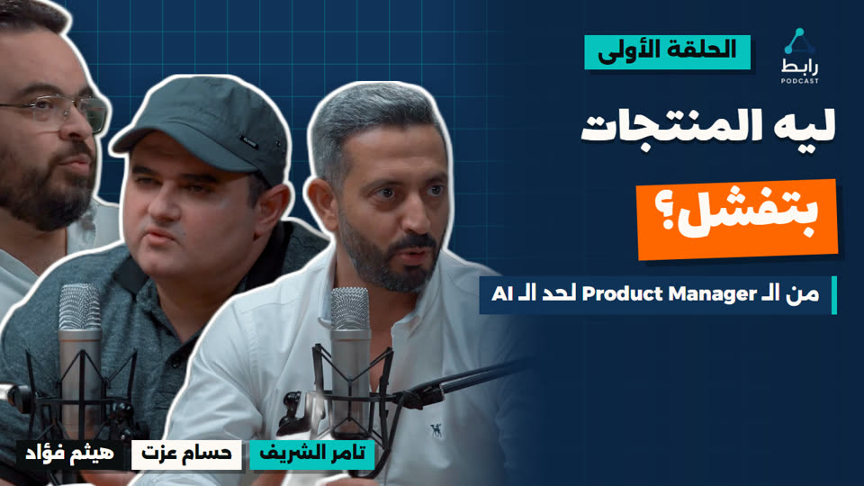
  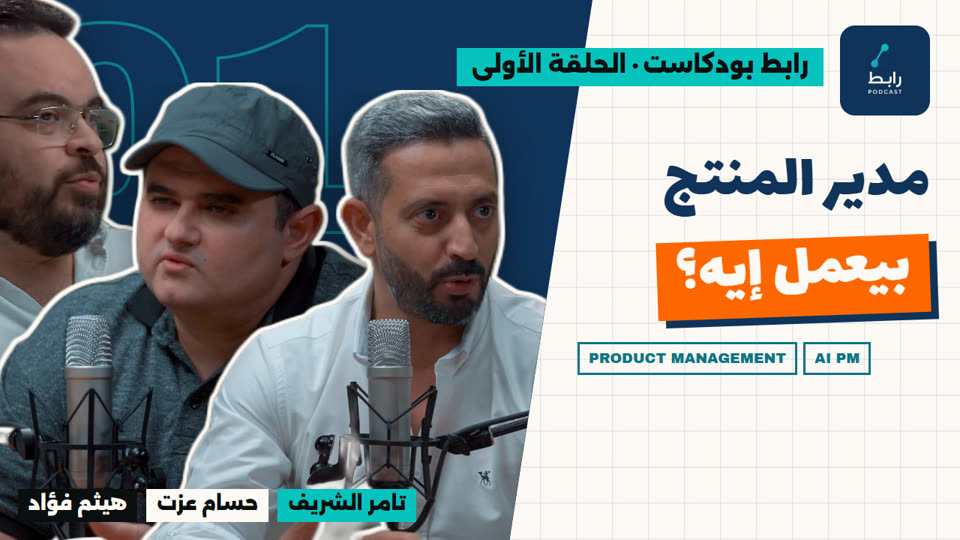
  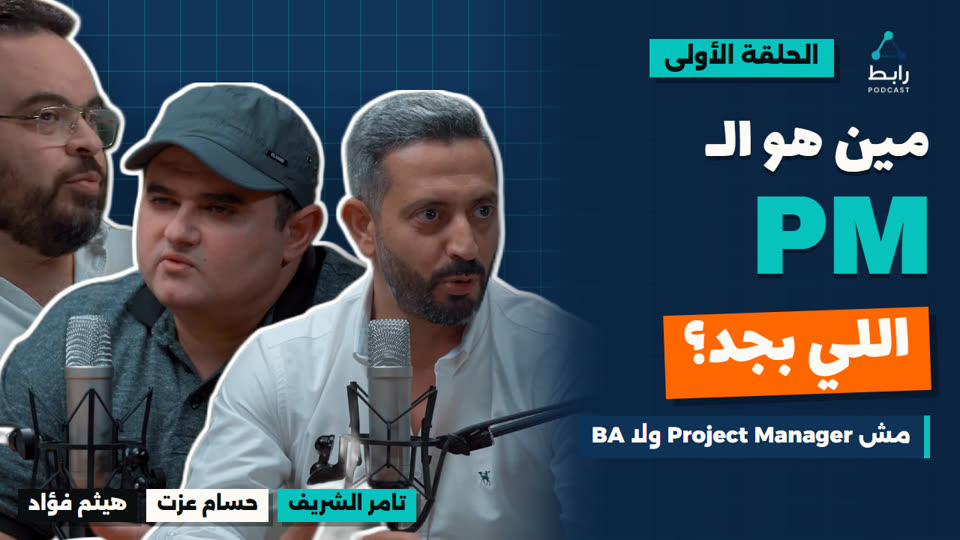
</p>
<p>
  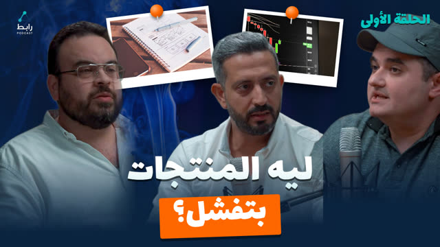
  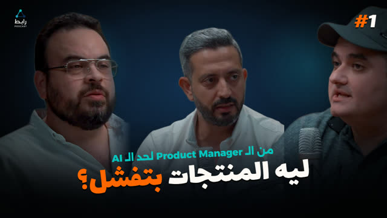
  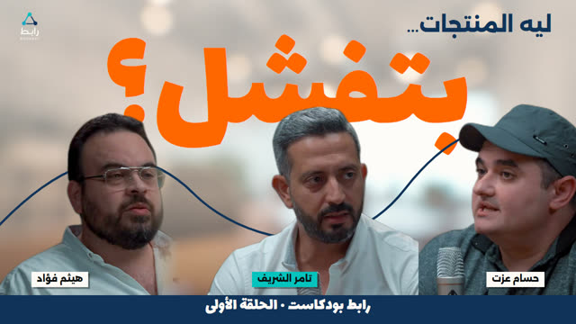
</p>

---

## What it's for

Editing a 60–80 min bilingual podcast into 20+ publishable pieces by hand takes days, and the details are easy to get
wrong: a cut that clips the first syllable of a word, an English word that flips an Arabic headline, a pop-up over a
face, a YouTube link that kills Facebook reach. This set packs everything learned on Episodes 1–3 into repeatable
skills, so you (or a partner) can come back after months and get the same quality with one sentence.

## When to use it

| Say this… | Skill that runs |
|---|---|
| "Process the Episode 4 recording, review-first" | **rabet-studio**: the whole pipeline |
| "Make a 45-second teaser for this episode" / "cold open for this reel" | **rabet-teaser** |
| "Split the episode into mini episodes" / "one episode about X from all over the recording" | **rabet-episodes** |
| "Make the next reel" / "reels from these moments" | **rabet-reels** |
| "Add the subscribe button at 4:30 and 32:03" | **rabet-subscribe** |
| "Make a name card for our new guest" | **rabet-namecards** |
| "Thumbnails for the episode" / "the same thumbnail in collage and giant style" / "a cover for this Short" | **rabet-thumbnails** (asks which styles if you don't say; new styles can be added) |
| "Titles, description and chapters" | **rabet-youtube** |
| "Write the posts and schedule the reels for next week" | **rabet-social** |
| "/rabet-post-rabet reels 5 to 8" / "schedule on the Rabet pages only" | **rabet-post-rabet** |
| "/rabet-tamer-draft the full episode" / "post on Rabet, draft on my channels" | **rabet-tamer-draft** |
| "/rabet-tamer this week's reels" / "schedule on my own accounts only" | **rabet-tamer** |

**Not for:** other podcasts' branding (the colours, logo, names and rules are Rabet's), live streams, or music videos.

## Install

**Recommended: all skills, side by side** (the sub-skills share the `rabet-reels` engine, so they must sit together):

```bash
git clone https://github.com/TamerElsherif/tamer-skills.git
cd tamer-skills/rabet-podcast-studio
bash install.sh                                           # macOS / Linux / Git Bash
powershell -ExecutionPolicy Bypass -File install.ps1      # Windows PowerShell
```

This copies the 9 skills into `~/.claude/skills/` and creates `~/.rabet-reels.json` from the example if you
don't have one. Re-run it to update.

**As one skill package** (it routes to the sub-skills inside, but they aren't separately triggerable):

```bash
npx skills add TamerElsherif/tamer-skills --skill rabet-podcast-studio --agent claude-code
```

**Then fill in `~/.rabet-reels.json`** with your intro/outro logo paths, name-card MOVs, output folder and
Postiz URL/token file. Every key is explained in `skills/rabet-reels/config.example.json`. Tokens stay in that file
or in env vars, never in the skill.

> The older standalone `rabet-reels` folder in this repo is the same skill as `skills/rabet-reels` here; the
> installer overwrites it with this newer copy.

## How to use

Just talk to Claude Code in a project that has the episode file (or point to it). Examples:

### 1. The whole package, with approvals

> Process `D:/Video Editing/Episode 4/Ep4 raw.mp4`. Review-first. Guests: Haitham and Hossam.

Claude asks **review-first or autopilot**, confirms names, titles and the output folder, then:

1. Transcribes (GPU Whisper), finds shots and speakers, and builds a topic map.
2. ◆ Suggests teaser lines, then builds teaser → intro → episode → outro, with name cards and subscribe pop-ups (◆ times).
3. ◆ Suggests 4–7 mini episodes and 8–15 reels, then cuts them.
4. ◆ Thumbnails, ◆ titles, descriptions with chapters, and humanized posts for each platform.
5. ◆ Posting calendar, then Postiz/Zernio **drafts**.
6. Hands over a review page listing every file and decision, and what wasn't watched end to end.

In **autopilot** it skips the ◆ stops and you review at the end. In both modes nothing is posted publicly without
your OK.

### 2. A teaser

> Make a 45 s teaser for Episode 4 with name cards and the logo at the end.

You get a list of moments first (time · speaker · first…last words · why it hooks), then the video. Every edge is
snapped into a real word gap and checked by transcribing each piece on its own.

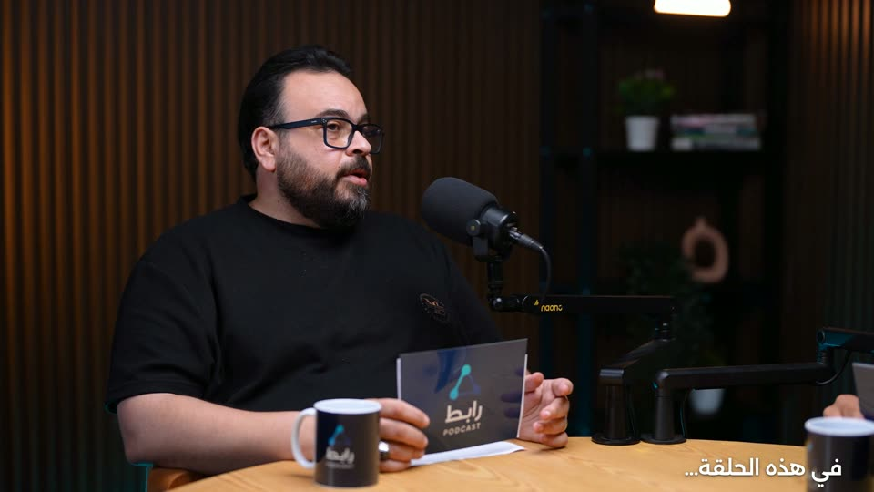

### 3. Subscribe pop-up

> Add the subscribe pop-up at 4:30, 32:03, 1:01:50 and 1:18:59. The master has the Rabet logo bottom-right.

```bash
python skills/rabet-subscribe/scripts/add_subscribe.py "Ep4 Final.mp4" 4:30 32:03 1:01:50 1:18:59 --clear-logo
```

<p>
  
  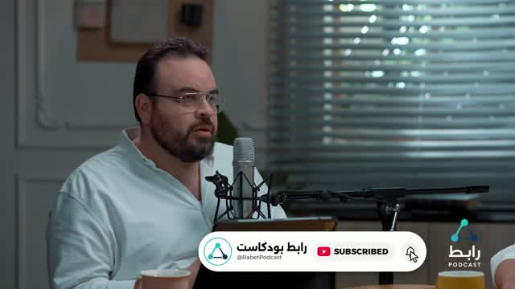
</p>

Animation: card pops in → cursor clicks **Subscribe** → bell rings → card pops out, in 6 s with sound. Available
in English (SUBSCRIBE) and Arabic (اشترك), at any size: 16:9, 9:16 or 4K.

### 4. Name card for a new guest

```bash
python skills/rabet-namecards/scripts/make_namecard.py --name "هيثم فؤاد" --title "Founder - prodXeed" --key haitham
python skills/rabet-namecards/scripts/add_namecard.py "Ep4.mp4" NameCard_haitham.mov@1:58
```

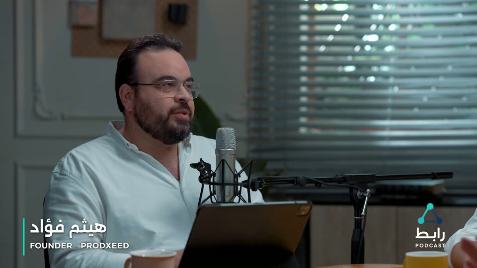

### 5. Mini episodes

> Split Episode 1 into consolidated mini episodes with swipe transitions, name cards and pop-ups.

Episode 1 became 6 sub-episodes (7–20 min). Each has a cold-open hook, intro and outro logos, jump cuts with
punch-ins, swipes between distant parts, name cards and three pop-ups, plus a .docx brief (cut list, chapters, B-roll
ideas). Every joint is checked afterwards on this contact sheet:

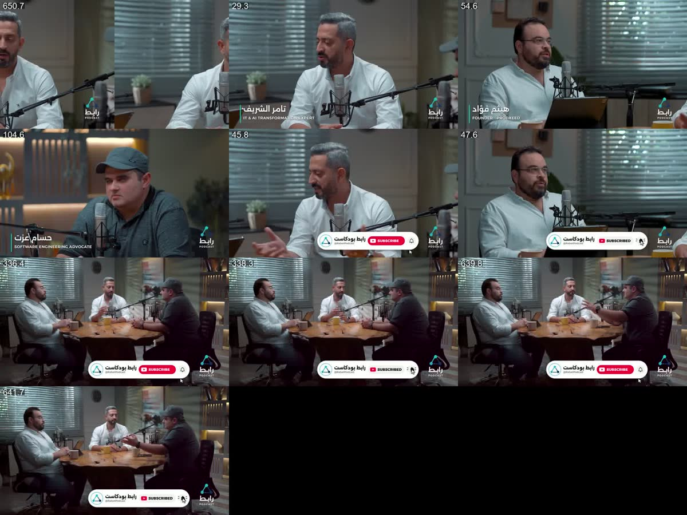
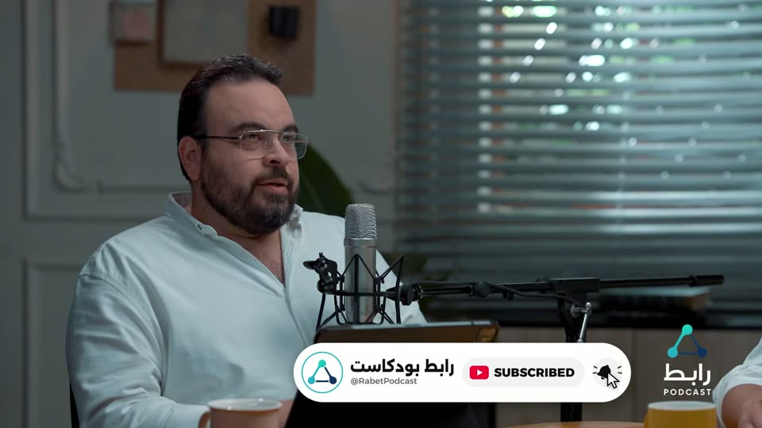

### 6. Reels and covers

> Make the next 3 reels from the clip sheet, S1 style, and schedule them as drafts.

<p>
  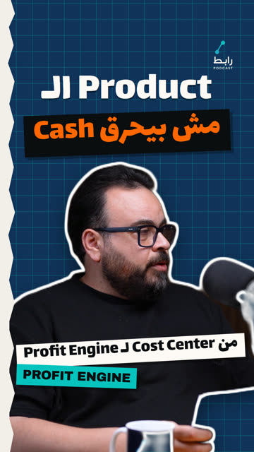
  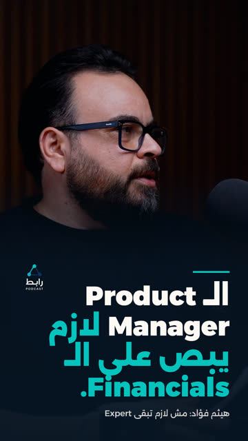
  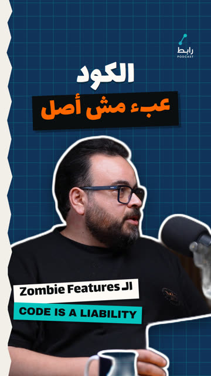
  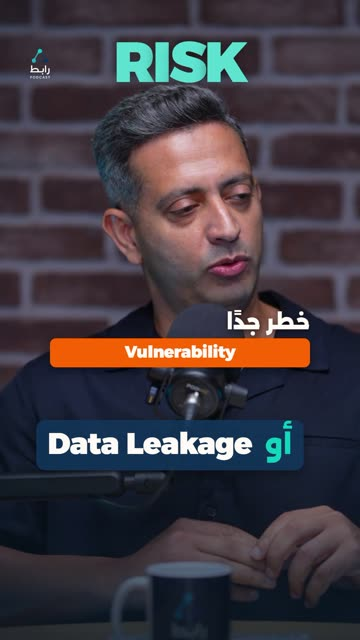
</p>

### 7. YouTube text and posts

> Titles, description with chapters and LinkedIn links, then LinkedIn and Facebook posts for the full episode.

You get 5 titles (each paired with a thumbnail) and a humanized Egyptian-Arabic description with guest/host links
and chapters timed to the uploaded file. Facebook and LinkedIn posts put the YouTube link in the first comment.

### 8. Schedule on the right channels, at the best times

> /rabet-tamer-draft reels 5 to 8, starting Thursday.

Three posting skills pick the channel set; all of them choose each post's day and time for Rabet's audience
(Cairo time, Sunday to Thursday work week, evening peaks; `rabet-social/references/timing.md`), skip days a
channel already has a post, and show the calendar before creating anything.

| Skill | Rabet Podcast channels | Host's own channels |
|---|---|---|
| rabet-post-rabet | scheduled | not touched |
| rabet-tamer-draft | scheduled | Postiz drafts, one day after the Rabet post |
| rabet-tamer | not touched | scheduled |

```bash
python skills/rabet-social/scripts/plan_slots.py --group both --items "Reel 05" "Reel 06" --start 2026-11-05 --busy busy.json
```

Channel ids and Zernio queue ids come from `~/.rabet-reels.json` (`channels`, `zernio.queues`); Zernio posts go into
their episode's queue with an explicit time, so the queue never moves them. Measured best times
(Zernio `analytics_get_best_time_to_post`) replace the table only once a slot has 5+ posts behind it.

### 9. Upload big videos to YouTube, into the right playlist

> Upload the 6 mini episodes to the Rabet YouTube channel as private.

Mini and full episodes are hundreds of MB to several GB. A Postiz server behind Cloudflare rejects any upload over
100 MB (HTTP 413), so the skills check every file's size first:

- **Under 100 MB:** normal Postiz upload.
- **Over 100 MB:** Claude tells you which files and sizes, then opens a **temporary Cloudflare quick tunnel** that
  serves only those files, and Postiz pulls them by URL:

```bash
python skills/rabet-social/scripts/tunnel_upload.py start "Sub-01.mp4" "Sub-02.mp4"   # one https URL per file
python skills/rabet-social/scripts/tunnel_upload.py wait                              # until Postiz finishes pulling
python skills/rabet-social/scripts/tunnel_upload.py stop                              # close tunnel, delete temp links
```

  The files are hard-linked into a temp folder (no extra disk space, originals never touched), and `stop` always
  closes the tunnel and removes the folder. Each media item's size is checked against the local file before posting.
- **Posting:** one video at a time (parallel posts failed with "byte range" errors), private by default, with title,
  description, chapters, tags and thumbnail.
- **Over ~1 GB:** Postiz's URL upload stops there. A file just over it gets a temporary ~900 MB re-encode; a
  3–4 GB full episode goes through Zernio (if YouTube is connected there) or YouTube Studio.

**Playlists:** full episodes go to **Full Episodes**, mini episodes to **Mini Episodes - Topics**, with category
Science & Technology and language Arabic. Zernio sets all of this at upload time (`playlistId`, `categoryId`). Postiz
can't, so you get a short checklist per video for YouTube Studio. The names live in `~/.rabet-reels.json` →
`youtube.playlists`.

## The house rules every skill follows

- **Never cut inside a word.** Cuts land in real acoustic gaps (`cutsafe.py`), and every edge is re-transcribed in
  isolation (`edge_check.py`, `tail_check.py`).
- **Complete ideas only:** a clip starts on a sentence start and ends on a sentence end; hooks are complete micro-ideas.
- **Graphics never cover a face.** The subscribe card goes bottom-right and name cards bottom-left, never at the same moment.
- **RTL-safe Arabic:** no line starts with an English word, and big headlines carry no English.
- **Brand:** navy `#10335A`, aqua `#07C3BE`, orange `#FF6600` (accent only), cream `#FDF9F5`; Alexandria and Lalezar fonts.
- **Sound effects sit under the voice** (gain 0.6). Music only on teasers.
- **Nothing public without approval:** drafts first, scheduling after you confirm.
- **Honest hand-over:** it says what was checked and what wasn't watched end to end.

## Layout

```
rabet-podcast-studio/
├── SKILL.md                    router: which sub-skill for which request
├── README.md                   this file
├── install.sh / install.ps1    copy all skills into ~/.claude/skills
├── .claude-plugin/plugin.json  plugin manifest
├── docs/images/                screenshots of real output (Episodes 1 and 3)
└── skills/
    ├── rabet-studio/           orchestrator: review-first or autopilot pipeline
    ├── rabet-teaser/           teasers, promos, cold opens  (scripts/make_teaser.py)
    ├── rabet-episodes/         mini / sub / topic episodes  (prep, pauses, check_edges, build, qa, brief, render_cta)
    ├── rabet-reels/            9:16 reels + SHARED ENGINE: fonts, logo, SFX, config, cutsafe, edge/tail checks,
    │                           Whisper, mattes, HyperFrames templates, thumbnail scripts, Postiz scripts
    ├── rabet-subscribe/        subscribe pop-up  (scripts/add_subscribe.py)
    ├── rabet-namecards/        name cards  (scripts/make_namecard.py, add_namecard.py, templates/namecard.html)
    ├── rabet-thumbnails/       16:9 YouTube + 9:16 covers (uses rabet-reels scripts/templates)
    ├── rabet-youtube/          titles, descriptions, chapters, hashtags
    ├── rabet-social/           humanized posts + Postiz / Zernio scheduling
    │                           (scripts/tunnel_upload.py: temporary public URL for uploads over 100 MB;
    │                            scripts/plan_slots.py + references/timing.md: best day/time calendar)
    ├── rabet-post-rabet/       schedule on the Rabet Podcast channels only
    ├── rabet-tamer-draft/      schedule on Rabet + drafts on the host's channels
    └── rabet-tamer/            schedule on the host's channels only
```

## Dependencies

| Need | Used for |
|---|---|
| Claude Code | running the skills |
| Python 3.11+ with `numpy`, `Pillow`, `faster-whisper` (CUDA for speed) | cuts, checks, transcription |
| `ffmpeg` + `ffprobe` (v7+; v8 tested) | every render; NVIDIA NVENC used when present, else libx264 |
| Node 18+ and `npx hyperframes@0.8.163` | reels, thumbnails, name cards, subscribe pop-up render |
| `onnxruntime-gpu` (optional) | fast speaker mattes for reels |
| Postiz instance and/or Zernio MCP connector | scheduling (optional) |
| `cloudflared` (optional) | temporary tunnel for Postiz uploads over 100 MB |
| `humanizer` skill | post and description text |
| Your assets | intro/outro logo videos, name-card MOVs, guest photos (paths in `~/.rabet-reels.json`) |

Tested on Windows 11 with an RTX 5050 (CUDA 12). GPU Whisper needs `cublas64_12.dll` next to ctranslate2; see
`skills/rabet-reels/SKILL.md` §5.

## Changelog

- **2026-11-03 · v1.4.0**: three posting sub-skills that pick the channel set: rabet-post-rabet (Rabet channels
  only), rabet-tamer-draft (Rabet scheduled, host channels as Postiz drafts a day later) and rabet-tamer (host
  channels only). New `plan_slots.py` and `references/timing.md` choose each post's day and time for the audience
  (Sun–Thu work week, evening peaks, one post per channel per day). rabet-social gained a channel-group table, Zernio
  episode queues (posts keep their time inside a queue) and the tag/mention rules; config example gained
  `zernio.profile_id`, `zernio.queues`, `fb_host`, `ig_host`.

- **2026-11-02 · v1.3.0**: YouTube thumbnail styles are now an open catalog instead of fixed A/B/C. Each style is one
  file in `rabet-reels/scripts/yt_styles/` and `yt_thumbs.py` renders any mix of them (`--list` shows what's
  installed). The classic Ep2/Ep3 looks stay as styles grid, board and word, with renders unchanged from before, and
  `make_episode_thumbs.py` still makes A/B/C from old specs. Per-style text in one spec, a guide for adding a
  style, and rabet-thumbnails asks which styles to build when none is named. Replaces `make_episode_styles.py` (v1.2.0).

- **2026-11-02 · v1.2.0**: four new YouTube thumbnail styles from reference images: collage (pinned topic photos on
  blue smoke), dark (close-up, small tilted question, «#N»), giant (huge orange word behind the speakers) and stage
  (curtain, spotlight, framed centre title). New `make_episode_styles.py` (spec-driven, 3 guests, per-style position
  overrides, right-edge fade for mic clips, a free Pexels `stock` helper for the collage photos) and bundled smoke and
  office backgrounds. rabet-thumbnails now asks which style to build when the request names none.

- **2026-11-01 · v1.1.0**: big-video uploads to YouTube. Size check first; over 100 MB goes through a temporary
  Cloudflare tunnel (`tunnel_upload.py`, cleans up after itself), one post at a time, the ~1 GB Postiz cap and the
  byte-range fix. Playlists: full episodes → «Full Episodes», mini episodes → «Mini Episodes - Topics» (set by
  Zernio at upload, or a Studio checklist with Postiz), plus category and language. New `youtube` block in the config.

- **2026-10-31 · v1.0.0**: first release as a skill set. Added rabet-studio (orchestrator), rabet-teaser,
  rabet-subscribe, rabet-namecards, rabet-thumbnails, rabet-youtube and rabet-social; bundled rabet-episodes and
  rabet-reels (v0.9). The pop-up gained a `right_edge` option for masters with a burned-in logo.
