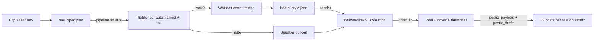

<div align="center">

# 🎬 rabet-reels

**Podcast episode in → captioned 9:16 reels, thumbnails and a scheduled social campaign out.**

Built for **رابط Rabet Podcast**: Egyptian Arabic with English tech terms, aimed at a B2B tech audience.


</div>

---

## ✨ What it is

A Claude Code skill and the toolkit behind it. It turns a long podcast episode into short vertical reels in one of three house styles. Each reel gets word-timed Arabic/English captions, animated graphics that stay off the speaker's face, sound effects, a branded thumbnail and a cover version. Then it drafts or schedules the whole campaign on [Postiz](https://postiz.com) across LinkedIn, YouTube Shorts, Facebook, Instagram and TikTok.

Everything is **data-driven**: a reel is one `reel_spec.json` (what to cut) plus one `beats_<style>.json` (what appears on screen and when). Scripts and HyperFrames templates do the rest.

## 🎯 What it's for

Repurposing a podcast by hand takes days per episode. You find the moments, tighten the pauses, reframe a multicam 4K master to vertical, fix Whisper's spelling of English words said in Arabic, keep graphics off faces, get right-to-left text right, then write and schedule a dozen posts per reel. This skill keeps all of that as reusable scripts and rules. Episode 2 of Rabet produced **8 reels and 96 scheduled posts** with it.

## 🧭 When to use it

- "Make the next reel" / "cut clip 07 from the sheet": building a reel from a clip list (start/end times, topic).
- Styling, captioning or re-rendering an existing reel. Making or fixing a reel thumbnail or a 16:9 episode thumbnail.
- Drafting or scheduling reels on Postiz with humanized Egyptian Arabic + English captions and a 4-week cadence.
- **Not for:** long-form editing of the full episode, English-only content (the caption rules are tuned for RTL Arabic), or music-driven edits (the house rule is SFX only).

## 📦 Install

```bash
npx skills add TamerElsherif/tamer-skills --skill rabet-reels --agent claude-code
# manual: copy the folder to .claude/skills/rabet-reels/ (project) or ~/.claude/skills/rabet-reels/ (user)
```

Then create your personal config **outside** the skill (it holds your Postiz token path and channel ids):

```bash
cp .claude/skills/rabet-reels/config.example.json ~/.rabet-reels.json   # then edit it
```

<details>
<summary><b>Prerequisites</b> (click)</summary>

| Need | Why | Notes |
|---|---|---|
| `ffmpeg` 8+ | cutting, loudnorm, covers | ffmpeg 8 syntax `-/filter_complex <file>` is used |
| Node + `npx hyperframes@0.8.163` | HTML/GSAP compositions → MP4 | `snapshot`, `check`, `render --sdr`, `remove-background` |
| Python 3.11+ with `faster-whisper` | word timings (Whisper large-v3) | GPU strongly recommended (CTranslate2 + CUDA 12 cuBLAS) |
| `opencv-python-headless<5` | face finding for multicam auto-framing | OpenCV 5 dropped `CascadeClassifier` |
| `onnxruntime-gpu`, `numpy`, `Pillow` (optional) | `gpu_matte.py`: ~10× faster speaker mattes | falls back to CPU `hyperframes remove-background` |
| A Postiz instance + API token | uploads, drafts, scheduling | self-hosted or cloud; MCP endpoint `/api/mcp` |
| Git Bash (Windows) or any bash | `pipeline.sh`, `finish.sh` | Windows paths handled with `pwd -W` |

</details>

## 🚀 How to use

Talk to Claude: the skill triggers on reel, clip-sheet, thumbnail and Postiz requests. Under the hood it runs this flow:



### Commands

```bash
S=.claude/skills/rabet-reels/scripts
bash $S/pipeline.sh <reel_dir> aroll   [s1|s2|s3]   # cut + tighten + auto-frame (fast)
bash $S/pipeline.sh <reel_dir> words   [styles]     # Whisper large-v3 word timings
bash $S/pipeline.sh <reel_dir> matte   [styles]     # refined speaker matte (S1/S3 only)
bash $S/pipeline.sh <reel_dir> render  [styles]     # data → assemble → ranged check → render → loudnorm
bash $S/pipeline.sh <reel_dir> all     [styles]     # everything in order

python $S/make_thumb.py <reel_dir>/thumb.json <reel_dir>/thumb.png          # 1080×1920 thumbnail
python $S/make_episode_thumbs.py episode_thumb.json                         # 3× 1280×720 YouTube episode thumbnails
bash   $S/finish.sh <reel_dir> 06 s3-bold Can-You-Make-Money                # copy + cover + upload
python $S/postiz_payload.py captions.json 06 uploads.json \
       Reel06_Can-You-Make-Money.mp4 Reel06_Can-You-Make-Money_cover.mp4 2026-10-22 payload.json schedule
python $S/postiz_drafts.py payload.json 06 posts.csv                         # create the 12 posts
```

- **Inputs:** an episode master (any resolution, multicam OK), the clip list, brand fonts/logo (bundled), speaker names.
- **Outputs:** `ReelNN_<Title>.mp4` (clean), `ReelNN_<Title>_cover.mp4` (thumbnail as a 1.2 s intro), `ReelNN_thumbnail.png`, a contact sheet per render, Postiz posts plus a CSV log of their ids.

### 🎨 The three styles

| Style | Template | Looks like | Best for | Matte |
|---|---|---|---|---|
| **S1 Clean** | `s1-clean` | Full-frame speaker, side stacks and a hero word behind the head | Calm advice, checklists, "how we work" | head region |
| **S2 Split** | `s2-split` | Cream board on top (panels, chips, diagrams), speaker panel below | Step-by-step teaching, frameworks, lists | none (fastest) |
| **S3 Bold** | `s3-bold` | Cut-out speaker with white outline on a cool navy grid, slamming text boxes | Punchy, contrarian, quotable ideas | head + full body |

| Thumb | Look | Best for |
|---|---|---|
| **T1** | Cut-out + big two-line question/claim | One sharp question |
| **T2** | Cinematic blurred background + cut-out + stamp | Metaphors (traffic, red button…) |
| **T3** | Editorial still + quote with a highlighted phrase | Teaching moments |

## ⚙️ Parameters

<details open>
<summary><b><code>~/.rabet-reels.json</code>: your settings</b></summary>

| Key | Meaning |
|---|---|
| `output_dir` | where `finish.sh` puts finished reels (`~` allowed) |
| `postiz_url` | your Postiz base URL, e.g. `https://postiz.example.com` |
| `postiz_token_file` | file holding the API token. The raw token or a `claude mcp add … "Authorization: Bearer <token>"` line both work |
| `channels.<key>.id` / `.name` | Postiz integration id and label for `li_host`, `yt_brand`, `yt_host`, `fb_brand`, `fb_host`, `ig_brand`, `ig_host`, `tiktok` |

**Env overrides:** `RABET_REELS_CONFIG` (config path), `POSTIZ_URL`, `POSTIZ_API_KEY`, `POSTIZ_TOKEN_FILE`, `POSTIZ_MCP_URL`, `RABET_OUTPUT_DIR`, `RABET_PY` (Python used by the shell scripts), `RABET_SFX_GAIN` (SFX volume multiplier, default 0.6), `RABET_DEBUG_TOKENS=1` (print the caption tokens when an anchor is missing).
</details>

<details>
<summary><b><code>reel_spec.json</code>: what to cut</b></summary>

| Key | Default | Meaning |
|---|---|---|
| `source` | required | episode master |
| `range` or `ranges` | required | `[a,b]` seconds, or `[[a,b],[c,d]]` joined in order |
| `styles.<s>.crop` | per `styles.json` | `vertical`, `split`, `auto-vertical`, `auto-split` (multicam face tracking) |
| `styles.<s>.hook` | `[]` | `[[a,b]]` cold-open ranges placed before the body |
| `drop_words` / `drop_ranges` | `[]` | fillers to cut (words) / manual cuts `[[a,b]]` |
| `words_json`, `words_offset` | none | a wider transcript used to find words to drop |
| `noise_db`, `min_silence` | `-32`, `0.12` | silence detection |
| `min_island`, `merge_gap`, `pad_pre`, `pad_post` | `0.12`, `0.22`, `0.06`, `0.10` | speech-island tightening |
| `fps`, `src_width`, `out_dir` | `25`, `3840`, required | output frame rate, source width, media folder |
</details>

<details>
<summary><b><code>beats_&lt;style&gt;.json</code>: what appears and when</b></summary>

| Key | Meaning |
|---|---|
| `emphasis` | words highlighted in captions |
| `fixes` | Whisper spelling fixes for this reel (on top of `glossary.json`). `""` drops a token |
| `chunking` | caption chunking, e.g. `{"max_words": 3, "max_chars": 16}` |
| `anchors` | named times: `{"word":"Sales"}`, `{"word":"الناس","n":2}`, `{"word":"X","in":"hook"}`, `{"after":"id","offset":0.4}`, `{"time":0.6}` |
| `content` | template data: `name`, `title`, `cta`, `zoom`, `hero`, and per style `stacks[]` (S1), `panels[]` (S2), `groups[]` (S3), plus `sfx[]` with `{"at": anchor, "file", "vol", "dur"}` |
| `extra_words`, `wide_words` | inject words / use a wider transcript when the A-roll transcript is poor |
| S1 placement | `stackLeft`, `stackWidth`, and per stack `left`, `width`, `top`, `front:true` |
| `content.sfxGain` | per-reel SFX volume multiplier (house default 0.6) |

Every anchor must resolve, so `make_reel_data.py` fails loudly on a typo.
</details>

<details>
<summary><b><code>thumb.json</code>: the thumbnail</b></summary>

| Key | Used by | Meaning |
|---|---|---|
| `type` | all | `T1`, `T2`, `T3` |
| `l1`, `l2` | T1, T2 | headline lines (no English at the start of a wrapped line) |
| `l1html` | T3 | headline with `<span>` for the highlighted part |
| `kicker`, `chip1`, `chip2`, `stamp`, `tag` | T1, T2, T3 | supporting text |
| `subject`, `subjectBox` | T1, T2 | cut-out PNG and `{left, top, width}` |
| `bg` / `frame`, `frameLeft` | T2 / T3 | background image / video still and its offset |
</details>

## 💡 Examples

**1. Build the next reel from the sheet**
> *"Make Clip ID 9 from the sheet, pick the best style and thumbnail."*

Claude reads the row, writes `reel_spec.json` with a hook range, runs `aroll` → `words` → `matte`, then writes `beats_s1.json` (a calm advisory clip gets S1). It snapshot-checks the stacks against the speaker's head, renders, and checks the contact sheet before calling it done.

**2. Fix a reel that went wrong**
> *"Reel 06: from second 11 Khaled's video freezes but the captions keep going. Fix it and update Postiz."*

Claude compares the render with the A-roll and the cutout, finds where the render stalled, re-renders on its own, and runs a freeze check on every reel. It then re-uploads and replaces that reel's 12 posts, new ones first and old ones deleted after.

**3. Run the campaign**
> *"Schedule all reels on Postiz as a 4-week campaign, cover video on feeds, stories with the clean video."*

For each reel: `finish.sh` builds the cover and uploads, `postiz_payload.py … schedule` builds 8 channel posts with first comments plus 4 stories at the Cairo time slots (DST handled), and `postiz_drafts.py` creates them and logs the ids.

**4. A word got clipped at a cut**
> *"At 0:10 it cuts in the middle of «costs». Never cut inside a word."*

Claude re-places every cut with `cutsafe.py`. Whisper had put the next word 0.15 s early, so the cut landed on the "s". The real gap was the dip at 54.57 s, where both the voice and the hiss drop. It moves boundaries with no real gap to another phrase break, re-renders, and runs `edge_check.py` so every part's first and last words are confirmed whole.

**5. Ship the full episode on YouTube**
> *"Create 3 thumbnail variants for Ep3, suggest title, description and hashtags, include the topics and the guests' LinkedIn links."*

Claude cuts out each guest from a 4K frame, writes an `episode_thumb.json` spec and runs `make_episode_thumbs.py` for variants A/B/C. It then writes title options and a description with chapters taken from the clip times (shifted by the teaser length when the upload has one), the guests' titles and LinkedIn links, the channel link and hashtags.

## 🗂️ Layout

```
rabet-reels/
├── SKILL.md                 # rules, fast path, gotchas: what Claude follows
├── README.md                # this file
├── config.example.json      # copy to ~/.rabet-reels.json
├── assets/                  # fonts (Alexandria, Lalezar), logos, SFX
├── templates/
│   ├── s1-clean/            # S1: behind-layer graphics + speaker matte
│   ├── s2-split/            # S2: board + speaker panel
│   ├── s3-bold/             # S3: cut-out speaker + box groups
│   ├── thumb/               # parametric T1/T2/T3 thumbnail
│   └── thumbs/              # original thumbnail samples
└── scripts/
    ├── pipeline.sh          # one command per stage
    ├── build_aroll.py       # silence tightening, hooks, multicam auto-crop
    ├── cutsafe.py           # surgical cut points: never inside a word
    ├── edge_check.py        # pre-delivery check: is any edge word clipped?
    ├── tail_check.py        # pre-build check: does the reel end where the idea ends?
    ├── shots.py             # camera cuts + face position per shot
    ├── transcribe_words.py  # Whisper large-v3 word timings
    ├── glossary.json        # spelling fixes, English phrases, caption break rules
    ├── make_reel_data.py    # captions + anchors → reel-data.js
    ├── refine_matte.py      # clean head/body matte
    ├── gpu_matte.py         # GPU mask path (onnxruntime-gpu)
    ├── assemble.py          # stamps a template into a HyperFrames project
    ├── styles.json          # style → template + matte needs
    ├── make_thumb.py        # thumbnail renderer
    ├── make_episode_thumbs.py # 16:9 episode thumbnails A/B/C (2–3 guests)
    ├── add_cover.py         # thumbnail as a 1.2 s intro
    ├── finish.sh            # ship: copy + cover + upload
    ├── config.py            # loads ~/.rabet-reels.json
    ├── postiz_upload.py     # media upload (cached by name+size)
    ├── postiz_payload.py    # 12 posts per reel, RTL-safe HTML, Cairo slots
    └── postiz_drafts.py     # creates posts via the Postiz MCP endpoint
```

## 🧱 House rules (enforced by the skill)

- Graphics **never cover a face**. They go beside, above, below or behind the speaker cut-out.
- A hook in the first 1–3 s, SFX only (no music, at 0.6× volume), and a CTA to the full episode.
- **Surgical cuts:** never cut inside a word. Sheet times are whole seconds and Whisper word edges drift, so every cut is moved into a real acoustic gap by `cutsafe.py` (it hears the hiss of a final "s" as speech), and `edge_check.py` confirms each part's first and last words are whole before delivery. Before building, `tail_check.py` reads 15 s past every planned end so a reel never stops mid-thought.
- **Complete ideas only:** a reel starts on a sentence start and ends on a sentence end. Never end on the first words of the next idea, never start mid-sentence.
- **Hooks are a complete micro-idea** (no trailing «أو / و / ف», no leading «كده / فهو / أو»), and a brand wipe covers the cut from hook to story so it doesn't read as the hook continuing.
- English terms stay in Latin script. **No line or headline starts with an English word**, and Arabic lines start with RLM (U+200F).
- Name cards appear only while the named speaker is on camera.
- One reel per topic. Choose the style by content, not by habit.

## 🛠️ Troubleshooting

| Symptom | Cause → fix |
|---|---|
| Speaker video freezes while captions continue | render under heavy CPU load. Re-render alone, check with `ffmpeg … freezedetect` |
| Ghost glyphs overlapping captions (S3) | chunk shorter than the pop-in. Fixed in the template; look for caps with `e − s < 0.12` |
| English word jumps to the start of a line | a wrapped mixed line. S1 stacks shrink to fit, so keep English mid-line or in its own box |
| Dim render, missing alpha, 10-minute render | HDR stock footage. Tone-map to BT.709 and render with `--sdr` |
| Postiz 403 | Cloudflare blocks the default Python user agent. Scripts send a curl UA |
| Postiz YouTube thumbnail rejected | known Postiz validation issue. Use the cover video and set the thumbnail in Studio |
| A navy panel covers the whole reel after the hook | an overlay had a CSS `transform` plus a GSAP `xPercent`. Position overlays only through GSAP (fixed in the templates) |
| Captions miss words, or an anchor isn't found | GPU Whisper sometimes drops words in a cut. Caption from the wide CPU transcript (`wide_words`) and run with `RABET_DEBUG_TOKENS=1` to see the tokens |
| Render fails at "capture_disk" | not enough free space on C: (an S3 render needs about 4 GB of temporary frames) |

## 🔗 Dependencies

[HyperFrames](https://github.com/heygen-com/hyperframes) · [faster-whisper](https://github.com/SYSTRAN/faster-whisper) · [FFmpeg](https://ffmpeg.org) · [OpenCV](https://opencv.org) · [Postiz](https://github.com/gitroomhq/postiz-app) · [GSAP](https://gsap.com)

## 📝 Changelog

- **2026-10-28**: v1.0. Partner review fixes: five Ep 3 reels ended mid-thought or inside the last word. New `tail_check.py` (own Whisper pass 15 s past a planned end, real pauses around it, isolated before/after check), house rule 18 (extend while the next words continue the idea; never ship a cutsafe "kept" end; last caption = last spoken word), and §9 for fixing shipped reels (Drive replace, Zernio in-place video swap, paced Postiz rebuild).
- **2026-10-28**: v0.9. Full-episode YouTube kit: `make_episode_thumbs.py` (three 1280×720 variants for 2–3 guests from a spec JSON) and a title/description recipe with chapters, teaser offset, guest LinkedIn links and hashtags. Facebook/LinkedIn posts carry no YouTube link in the text; the link goes in the first comment.
- **2026-10-25**: v0.8. Episode 3 (33 reels). Outro shows the channel link (no «مع …» line); cover-only delivery; S1 shirt stacks with `nameClear`; hero word above the head; `exact_ends`/`exact_starts` for edges in continuous speech; per-piece ffmpeg inputs (no 4K buffering); caption fixes (merged English terms, no prefix chunk ends, hook/body split, lowercase-English normalisation); strike-through on stack cards; Zernio drafts and draft→scheduled swaps.
- **2026-10-23**: v0.7. Surgical cuts: `cutsafe.py` places every cut in a real word gap (full-band + high-frequency level, first gap after speech for outs, last gap before speech for ins, soft tails extend to the pause). `build_aroll.py` uses it for every edge and picks the quieter neighbouring frame. New `edge_check.py` pre-delivery check. House rule 13.
- **2026-10-22**: v0.6. Brand LinkedIn page + brand TikTok via the Zernio connector (`zernio` block in the config; SKILL.md section 7).
- **2026-10-21**: v0.5. New house rules: reels start and end on a complete idea; hooks are a complete micro-idea followed by a brand wipe; SFX at 0.6× (`sfxGain`). Wide-transcript gap snapping, «ال -term» normalisation, `finish.sh` Windows-path fix.
- **2026-10-17**: v0.4. Portable config (`~/.rabet-reels.json`), draft or schedule posts, GPU Whisper and mattes, S1 placement knobs, S3 ghost-caption fix, `finish.sh`.
- **2026-10-16**: v0.1–v0.3. Three styles (Clean, Split, Bold) and T1–T3 thumbnails, then multicam auto-framing, generic engines (stacks/panels/groups), parametric thumbnails, Postiz upload and drafts.
