<div align="center">

# 🎬 Training Content Studio

**Turn any subject + your documents into finished, grounded training.**
Video · narrated decks · interactive HTML lessons · SCORM 1.2 · PDF job aids, in **English and Arabic (Egyptian / MSA, RTL)**.

`22 skills` · `10 formats` · `32 scene templates` · `6 outputs` · `/tcs-autopilot` · works in Claude Code, ChatGPT and Gemini

</div>


---

## Contents
[What it does](#what-it-does) · [60-second quickstart](#60-second-quickstart) · [How-to recipes](#how-to-recipes) ·
[Gallery](#gallery) · [Formats](#formats) · [Which skill when?](#the-skill-set-which-one-when) · [Autopilot flags](#autopilot-reference) ·
[Install](#install) · [Quality & testing](#quality--testing) · [Troubleshooting](#troubleshooting) · [Layout](#layout)

## What it does

You describe what people need to learn. The studio acts as a senior instructional designer and a subject-matter
expert. It asks only what's missing, shows you a plan, and after you approve it produces the whole course:

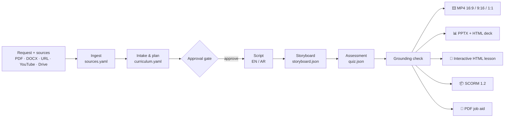

**Built-in guarantees**

| | |
|---|---|
| ✅ **Grounded** | Every claim cites a `source_id` or is labelled `general_knowledge`, and `tcs-grounding-check` verifies it. |
| 🔤 **No AI text in images** | All on-screen text, captions, diagrams and UI mock-ups come from templates. Image generators never draw text. |
| 🛑 **You approve first** | The orchestrator always shows the skeleton and the lesson-1 storyboard before generating. Autopilot only pauses if you ask. |
| 🌍 **Arabic is first-class** | RTL layouts, Arabic fonts, Egyptian or MSA narration, cultural adaptation, subtitles. |
| 🧩 **Any subject** | Add sources or a domain pack (`domains/`); the core skills never change. |
| 🪶 **Token-lean** | SKILL.md files stay under 300 lines; references load on demand; large sources are chunked and summarized. |

## 60-second quickstart

```bash
git clone https://github.com/TamerElsherif/tamer-skills
cd tamer-skills/training-content-studio
uv venv -p 3.12 .venv && uv pip install -p .venv/bin/python -r tools/requirements.txt
bash kit/setup.sh                      # video kit (Node 18+, ffmpeg); skip if you only need decks/SCORM
export OPENAI_API_KEY=...              # narration + transcription; PEXELS_API_KEY optional for stock b-roll
claude --plugin-dir .                  # load the plugin in Claude Code
```
Then just ask:
```
make a short course to teach my team Excel pivot tables
```
Or skip every question:
```
/tcs-autopilot "Teach new hires how to submit expenses in NetSuite" --sources ./sop/expenses.pdf
```

## How-to recipes

### 1. Build a course with you in the loop (orchestrator)
```
/tcs-orchestrator "Onboarding course on our refund policy for customer-service agents" (attach refund-policy.pdf)
```
1. It asks only the missing questions, in one round, each with a recommended default ("go with defaults" works).
2. It shows **modules → lessons → objectives → format → duration**, plus a storyboard for lesson 1.
3. You reply `approve` (or edit), and it produces scripts, storyboards, quizzes and the grounding report, then renders.

### 2. Fully automatic course (autopilot)
```
/tcs-autopilot "Explain our new data retention policy to managers" --sources ./policies/ --review skeleton
```
It decides audience, objectives, length, formats, language and outputs, logs each decision with a confidence score in
`decisions.md`, pauses after the plan (because of `--review skeleton`), then QA-fixes, renders and writes `REPORT.md`.
Resume with `--resume <run-id>`.

### 3. Arabic microlearning from an SOP folder
```
/tcs-autopilot "كورس قصير من 3 وحدات للموظفين الجدد عن إجراءات المشتريات" --sources ./sop/ --lang ar --targets video,lesson,scorm,jobaid
```
You get Egyptian Arabic narration (MSA if your wording is formal), RTL layouts, English subtitles, SCORM and a printable job aid.

### 4. A 90-second security micro-drama with a branching choice and a quiz
```
/tcs-orchestrator "90-second micro-drama on CEO-fraud payment requests, with a branching choice and a quick quiz, for all staff"
```
Uses the `security-awareness` domain pack (personas, red-flag mock-ups, ISO 27001 A.6.3 evidence line).
→ See `examples/golden-security-microdrama/`.

### 5. Turn an existing English lesson into Arabic
```
/tcs-localize make an Egyptian Arabic version of lesson M1L1 in runs/<id>
```
It adapts rather than translates, swaps cultural examples, mirrors layouts, picks Arabic voices, runs `rtl_lint`
and builds SRT/VTT subtitles.

### 6. Prioritize a big course catalogue
```
/tcs-curriculum rank this catalogue spreadsheet and pick the top 20 for staff, IT and executives
```
It scores each course on **impact × frequency × gap × urgency × compliance** with tunable weights, dedupes subjects,
applies audience quotas and gives a reason for each tier.

### 7. Only export: SCORM, deck or job aid from an existing storyboard
```bash
.venv/bin/python skills/tcs-render-lesson/scripts/html_lesson.py runs/<id> --lesson M1L1
.venv/bin/python skills/tcs-render-lesson/scripts/scorm.py --run runs/<id>
.venv/bin/python skills/tcs-render-lesson/scripts/deck.py runs/<id> --lesson M1L1
.venv/bin/python skills/tcs-render-lesson/scripts/jobaid.py runs/<id> --lesson M1L2
```

### 8. Render video (standalone or through OpenMontage)
```bash
.venv/bin/python skills/tcs-render-remotion/scripts/render_lesson.py runs/<id> --target video            # 16:9
.venv/bin/python skills/tcs-render-remotion/scripts/render_lesson.py runs/<id> --target video-vertical   # 9:16
OPENMONTAGE_ROOT=~/OpenMontage .venv/bin/python skills/tcs-render-remotion/scripts/render_lesson.py runs/<id> --target video --engine openmontage
```
Missing keys or assets never stop the run: placeholders are used and listed in `missing_assets.json` / `REPORT.md`.

### 9. Use it from ChatGPT or Gemini
Open `portable/README.md`: paste `portable/SYSTEM_PROMPT.md` into a custom GPT or Gem and attach `portable/attachments/`.
It plans and writes the same `storyboard.json` / `quiz.json`, then hands you the render commands.

## Gallery

| Narrated deck (from an SOP) | Arabic 9:16 (Egyptian, RTL) |
|---|---|
| 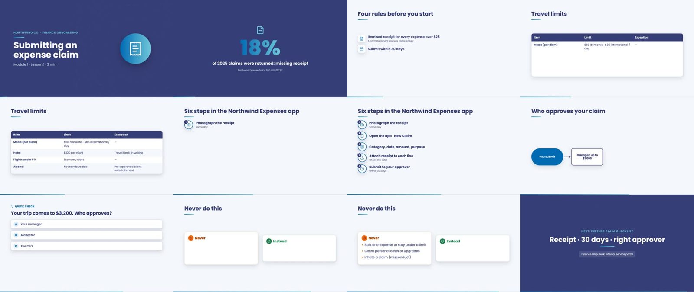 |  |

| One-page PDF job aid | Arabic HTML deck |
|---|---|
| 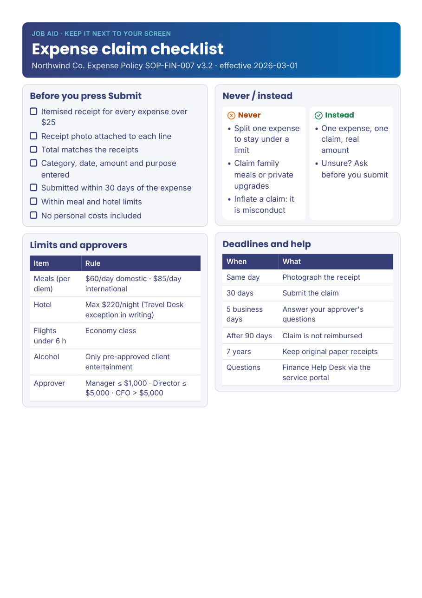 |  |

**Template gallery**: some of the 32 scene templates (definition, icon grid, steps, timeline, comparison, table,
stat, email, browser and MFA mock-ups, code, decision, outro…):

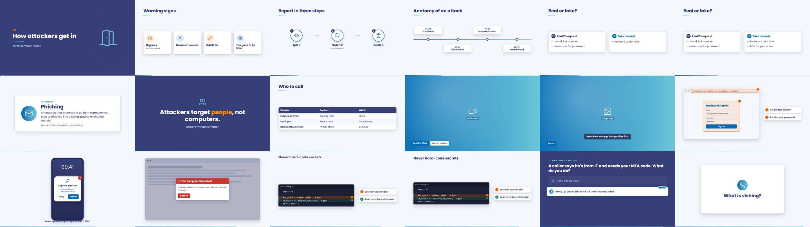

## Formats

| Format | Best for | Looks like | Skill |
|---|---|---|---|
| **Explainer** (+ B-roll, UI mock-ups, motion graphics) | concepts, "what & why" | 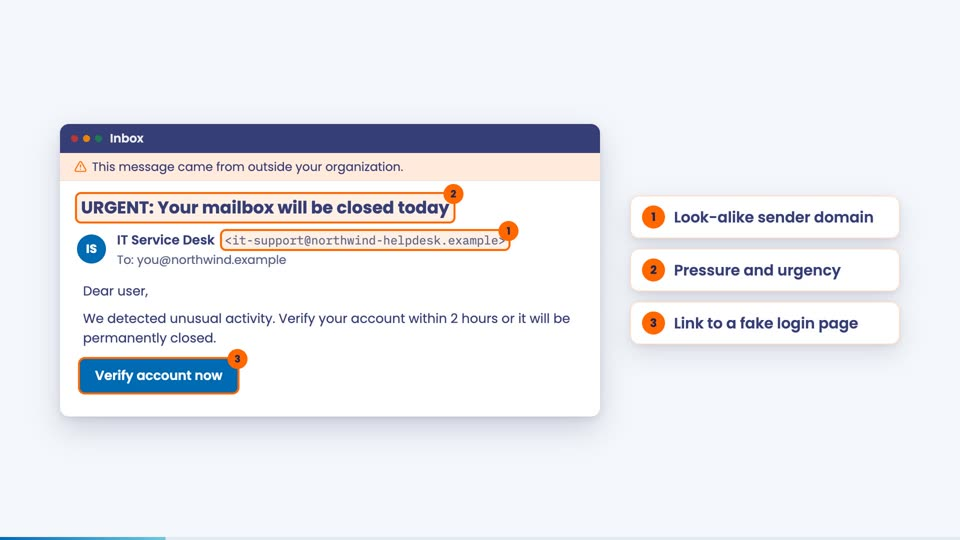 | `tcs-format-explainer` |
| **Whiteboard / doodle** | processes, simple ideas, friendly tone | 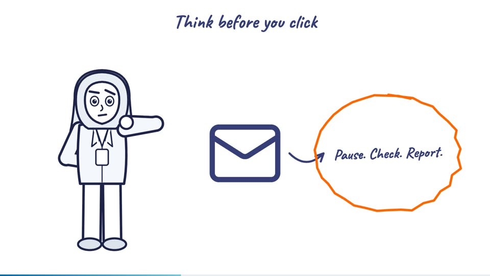 | `tcs-format-doodle` |
| **2D cartoon micro-drama** | behaviour, judgement, compliance stories | 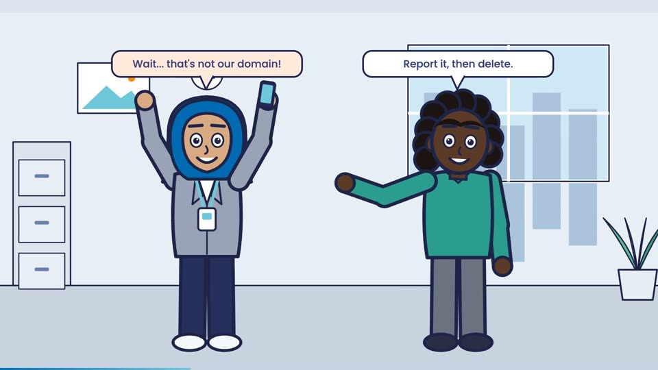 | `tcs-format-cartoon` |
| **Comic / webtoon** | quick stories, mobile reading | 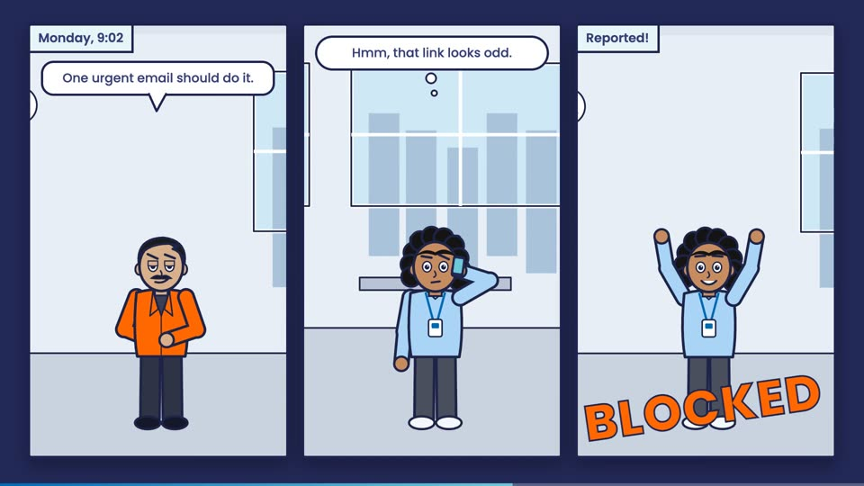 | `tcs-format-comic` |
| **Narrated deck** | executives, policies, briefings |  | `tcs-format-narrated-deck` |
| **Expanding mind map** | abstract structures, overviews | 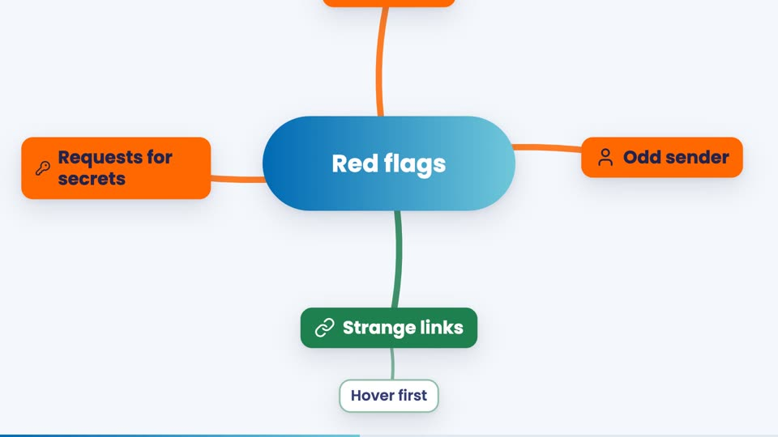 | `tcs-format-mindmap` |
| **Branching scenario** | decisions with consequences | 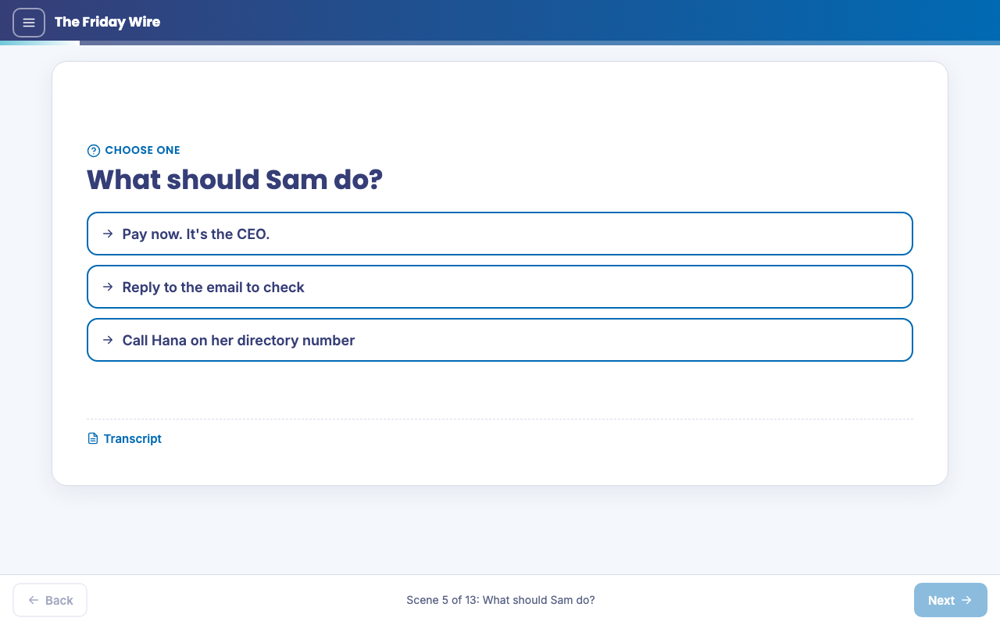 | `tcs-format-branching` |
| **Screencast + simulation** | software procedures, guided practice | 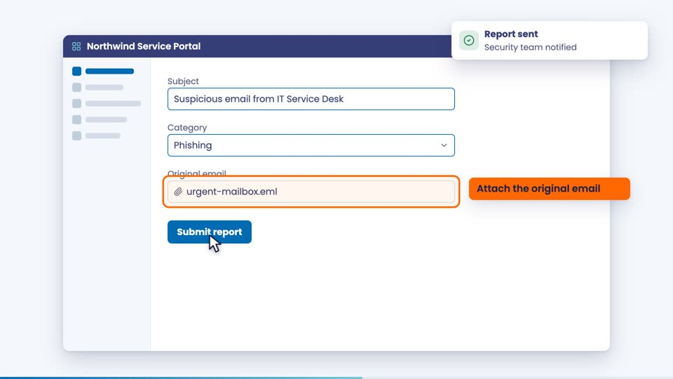 | `tcs-format-screencast-sim` |
| **Job aid / cheat sheet** | on-the-job reference (pairs with any format) |  | `tcs-format-job-aid` |
| **Episodic series + nudges** | multi-week adoption: points, streaks, 30-60 s nudges, flashcards | series plan + nudge calendar (renders as short videos and flashcards) | `tcs-format-series` |

Blends are composed automatically (max 2 formats per lesson, 3 per course), e.g. *cartoon + branching + quiz* or *explainer + job aid*.

**Building blocks every format can use**: process flows, quick checks, do/don't cards:

| | | |
|---|---|---|
| 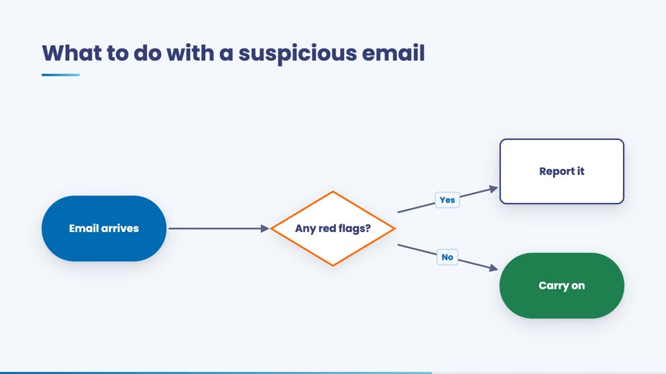 | 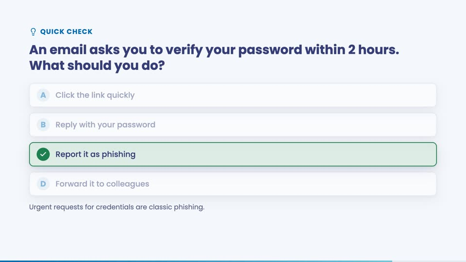 | 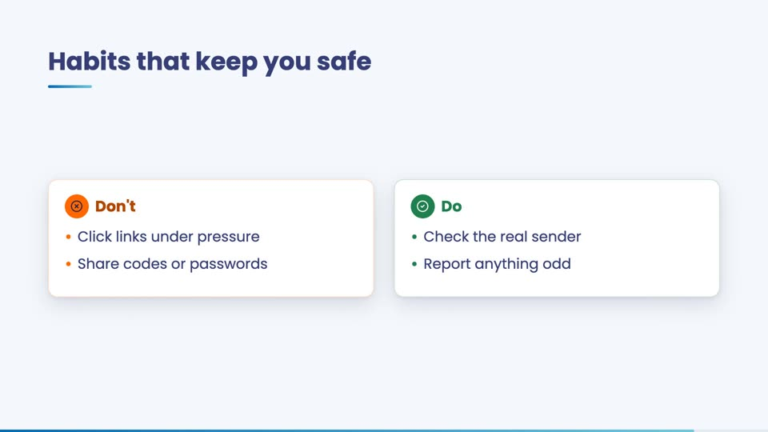 |

## The skill set: which one when?

You rarely call skills one by one. **Start with `tcs-orchestrator`** (you're in the loop) or **`tcs-autopilot`**
(no questions); they call the rest. Call a single skill directly when you only need that one step.

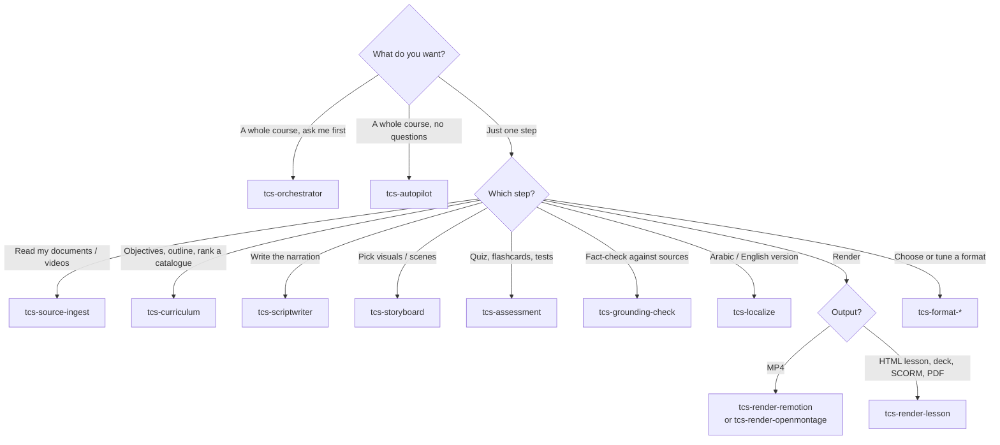

### Core skills
| Skill | Use it when… | Don't use it for… (use instead) | Try saying |
|---|---|---|---|
| **[`tcs-orchestrator`](skills/tcs-orchestrator/)** | the user is present, wants to be asked and to see the plan before anything is produced, and asks to "design / make / create / build a course, lesson, training video, e-learning module, onboarding or awareness training" | they say autopilot, "no questions" or "fully automated" (tcs-autopilot), and not for outline/prioritization only (tcs-curriculum) | `make a course to teach my team Excel pivot tables` |
| **[`tcs-autopilot`](skills/tcs-autopilot/)** | the user says "autopilot", "no questions", "just make it", "fully automated", "batch", or invokes /tcs-autopilot or a --resume | the user is present and wants to be consulted (tcs-orchestrator), and not for planning only (tcs-curriculum) | `/tcs-autopilot "Teach new hires how to submit expenses in NetSuite" --sources ./sop/expenses.pdf` |
| **[`tcs-source-ingest`](skills/tcs-source-ingest/)** | someone says "use these documents/this SOP/this video as the source", "ingest", "read my materials", or adds sources to an existing course | writing objectives or lessons (tcs-curriculum), narration (tcs-scriptwriter) or checking finished content against sources (tcs-grounding-check) | `ingest ./sop/ and this YouTube talk as sources` |
| **[`tcs-curriculum`](skills/tcs-curriculum/)** | someone asks to "plan / outline / structure a curriculum", "write learning objectives", "which courses should we build first", "prioritize this catalogue" or "rank these topics" | producing lessons, scripts or videos (tcs-orchestrator or tcs-autopilot) and not for ingesting source documents (tcs-source-ingest) | `rank this 216-course catalogue and pick the top 20 for staff, IT and executives` |
| **[`tcs-scriptwriter`](skills/tcs-scriptwriter/)** | "write the script/narration/voice-over", "make it shorter/longer", "rewrite in Egyptian Arabic", or "add dialogue" | choosing visuals/templates (tcs-storyboard), translating an existing lesson (tcs-localize) or quiz items (tcs-assessment) | `write the M1L2 narration in Egyptian Arabic, 4 minutes` |
| **[`tcs-storyboard`](skills/tcs-storyboard/)** | turn a script into a storyboard JSON — "storyboard this", "convert the script into scenes", "choose the visuals/templates", "show me the storyboard preview", or "fix the storyboard validation errors" | writing or retiming narration (tcs-scriptwriter), rendering (tcs-render-*) or translating (tcs-localize) | `turn the M1L1 script into a storyboard` |
| **[`tcs-assessment`](skills/tcs-assessment/)** | "make a quiz/test/knowledge check/flashcards", "add questions for objective O2", or "export the quiz to Moodle/CSV" | in-video quiz scene layout (tcs-storyboard), SCORM packaging (tcs-render-lesson) or fact checking (tcs-grounding-check) | `make 5 scenario questions for M1L1 mapped to the objectives` |
| **[`tcs-grounding-check`](skills/tcs-grounding-check/)** | "fact-check / verify / is this accurate / check against the sources / why did grounding fail" | ingesting sources (tcs-source-ingest), writing claims (tcs-scriptwriter) or schema/visual lint (tcs-storyboard) | `check every claim in M1L1 against the sources` |
| **[`tcs-localize`](skills/tcs-localize/)** | "make an Arabic version", "translate/localize this lesson", "Egyptian or MSA?", "add Arabic/English subtitles" | writing a lesson natively in Arabic from scratch (tcs-scriptwriter) or rendering (tcs-render-*) | `make an Egyptian Arabic version of lesson M1L1` |
| **[`tcs-render-remotion`](skills/tcs-render-remotion/)** | "render the video with Remotion", "standalone render", "make the vertical version", or "QA stills of the lesson"; it is the default video renderer | rendering through the user's OpenMontage install (tcs-render-openmontage), decks/HTML/SCORM/job aids (tcs-render-lesson), or writing/fixing storyboards (tcs-storyboard) | `render M1L1 to video, 16:9 and a 9:16 cut` |
| **[`tcs-render-openmontage`](skills/tcs-render-openmontage/)** | OPENMONTAGE_ROOT is set or the user asks to "render via/in OpenMontage" | OpenMontage is not installed (use tcs-render-remotion), for decks/HTML/SCORM (tcs-render-lesson), or to edit storyboards | `render this storyboard in OpenMontage` |

### Format skills: pick the format that fits the objective
| Objective type | Best format |
|---|---|
| Explain a concept ("what and why") | explainer, or doodle for a friendlier tone |
| Change behaviour, judgement or compliance | cartoon micro-drama + branching |
| Teach a software or step-by-step procedure | screencast-sim + job-aid |
| Brief executives or explain a policy | narrated-deck (+ job-aid) |
| Show how a big topic fits together | mindmap |
| Quick story for mobile / social | comic |
| Recall over weeks, adoption campaigns | series (nudges, flashcards, streaks) |

| Skill | Use it when… | Don't use it for… (use instead) | Try saying |
|---|---|---|---|
| **[`tcs-render-lesson`](skills/tcs-render-lesson/)** | targets lesson, deck, scorm or jobaid, or when asked to "export to SCORM", "make slides/PPTX", "build the e-learning page", "print a cheat sheet" | MP4/video renders (tcs-render-remotion / tcs-render-openmontage) and not for writing or changing content (tcs-storyboard, tcs-assessment, tcs-format-*) | `export the course as SCORM 1.2 for Tandrik` |
| **[`tcs-format-branching`](skills/tcs-format-branching/)** | the chosen or requested format is "branching", "scenario", "choose your own path", "decision simulation" or "what would you do" | knowledge-check quizzes alone (tcs-assessment) or software practice (tcs-format-screencast-sim) | `add a decision point where the learner picks what to do` |
| **[`tcs-format-cartoon`](skills/tcs-format-cartoon/)** | the chosen or requested format is "cartoon", "animated story", "micro-drama", "character scenario" or "skit" | static panel comics/webtoons (tcs-format-comic), hand-drawn whiteboard (tcs-format-doodle) or choose-your-path stories (tcs-format-branching, which may reuse these scenes) | `a 90-second cartoon micro-drama about a CEO-fraud email` |
| **[`tcs-format-comic`](skills/tcs-format-comic/)** | the chosen or requested format is "comic", "comic strip", "webtoon", "graphic story", "panels" or "motion comic" | fully animated stories (tcs-format-cartoon) or whiteboard drawings (tcs-format-doodle) | `turn the lesson into a 4-panel comic` |
| **[`tcs-format-doodle`](skills/tcs-format-doodle/)** | the chosen or requested format is "doodle", "whiteboard", "sketch", "draw-my-life" or "hand-drawn explainer" | flat motion graphics with B-roll (tcs-format-explainer) or coloured character stories (tcs-format-cartoon) | `do this lesson as a whiteboard doodle` |
| **[`tcs-format-explainer`](skills/tcs-format-explainer/)** | the chosen or requested format for an approved lesson is "explainer" (also "motion graphics", "B-roll explainer", "talking-points video") | hand-drawn/whiteboard looks (tcs-format-doodle), character stories (tcs-format-cartoon) or slide decks with speaker notes (tcs-format-narrated-deck) | `make it an explainer with stock footage` |
| **[`tcs-format-job-aid`](skills/tcs-format-job-aid/)** | the chosen or requested format is "job aid", "checklist", "cheat sheet", "quick reference", "one-pager", "poster" or "desk card", or when any lesson needs a performance-support takeaway | teaching from scratch (pair it with explainer/cartoon/screencast-sim etc.) or for slide decks (tcs-format-narrated-deck) | `add a one-page checklist they can print` |
| **[`tcs-format-mindmap`](skills/tcs-format-mindmap/)** | the chosen or requested format is "mindmap", "mind map", "concept map", "expanding diagram", "progressive reveal" or "big-picture overview" | linear procedures (tcs-format-explainer steps or tcs-format-screencast-sim) or hand-drawn boards (tcs-format-doodle) | `explain the policy structure as an expanding mind map` |
| **[`tcs-format-narrated-deck`](skills/tcs-format-narrated-deck/)** | the chosen or requested format is "narrated deck", "slides", "PowerPoint", "presentation with voice-over", "speaker notes" or "instructor-led deck" | animated explainers with B-roll (tcs-format-explainer) or one-page references (tcs-format-job-aid) | `narrated slides for the leadership team` |
| **[`tcs-format-screencast-sim`](skills/tcs-format-screencast-sim/)** | the chosen or requested format is "screencast", "software demo", "simulation", "guided practice", "try it", "click-through" or "system training" | decision dilemmas (tcs-format-branching) or concept explainers (tcs-format-explainer) | `show how to submit a claim in the expense app and let them practise` |
| **[`tcs-format-series`](skills/tcs-format-series/)** | the chosen or requested format is "series", "episodes", "campaign", "drip", "microlearning", "nudges", "spaced repetition", "gamification", "streaks" or "flashcards" | a single standalone lesson (pick that lesson's format skill) or for the course outline itself (tcs-curriculum) | `a 6-week series with weekly nudges and streaks` |

Every skill reads and writes only these contracts (`schemas/`): `sources.yaml` · `curriculum.yaml` ·
`<L>.storyboard.json` · `<L>.quiz.json` · `grounding_report.json` · `decisions.json` · `state.json`.

## Autopilot reference

```
/tcs-autopilot "<request>" [--sources <paths|urls|folder>] [--lang ar|en|both]
               [--targets video,deck,lesson,scorm,jobaid] [--aspect 16:9|9:16|1:1]
               [--review none|skeleton|final] [--budget <tokens|$>] [--domain <pack>] [--resume <run-id>]
```

| Signal | Default decision |
|---|---|
| "new hires", "my team", "engineers", jargon | beginner, beginner-intermediate or intermediate |
| *know / do / decide* verbs | Bloom remember-understand / apply / analyze-evaluate |
| procedure or software | screencast-sim + job aid |
| behaviour, judgement or compliance | cartoon micro-drama + branching + quiz |
| managers or executives | narrated deck (+ job aid) |
| Arabic request or MENA context | Arabic primary (Egyptian) + English subtitles, 10% slower narration |
| ≥ 2 lessons | adds SCORM; video formats add a 9:16 cut |
| high-stakes topic with no sources | plans only and asks for sources |

Tune everything in `skills/tcs-autopilot/decision-rules.yaml`. Explicit flags or wording always override.

## Install

```bash
# whole plugin (recommended)
git clone https://github.com/TamerElsherif/tamer-skills && claude --plugin-dir tamer-skills/training-content-studio
# or copy the whole folder into a project: .claude/plugins/training-content-studio
# (skills live in skills/<name>/; their scripts need the plugin root for schemas/, kit/, assets/)
```

| Need | For |
|---|---|
| Python 3.12 + `tools/requirements.txt` | every script |
| Node 18+, ffmpeg, `bash kit/setup.sh` | video renders |
| Google Chrome | PDF job aids, screenshots |
| `OPENAI_API_KEY` | narration (gpt-4o-mini-tts) + transcription (whisper-1) |
| `PEXELS_API_KEY` (optional) | stock b-roll |
| `OPENMONTAGE_ROOT` (optional) | render through OpenMontage |
| `yt-dlp` (installed via requirements) | YouTube/Vimeo ingest |

Keys can also come from a file named in `TCS_ENV_FILE`; they are never written to disk.

## Quality & testing

`QUALITY.md` is the release checklist (grounding, objective coverage, accessibility, Arabic rendering, no text in
generated images, licences, duration).

```bash
.venv/bin/python tools/validate.py                               # schemas, contracts, SKILL.md limits, 24 routing cases
.venv/bin/python tools/qa.py runs/<id>                           # per-lesson gate → qa/<L>.qa.json
.venv/bin/python skills/tcs-autopilot/scripts/test_decisions.py  # 9 golden autopilot decisions
bash skills/tcs-render-lesson/tests/run_all.sh                    # HTML / deck / SCORM / job-aid regression
```

| Example | What it shows |
|---|---|
| `examples/golden-security-microdrama/` | Intake → approved plan → cartoon + branching storyboard → quiz → grounding (21/24 sourced, 3 general knowledge) → 87 s MP4 + HTML + SCORM |
| `examples/golden-sop-deck-jobaid/` | SOP PDF → narrated deck in EN + Egyptian Arabic (152 s MP4, PPTX, HTML) + one-page job aid + 2-lesson SCORM |
| `examples/autopilot-runs/g1–g3` | The three golden autopilot decisions |

## Troubleshooting

| Symptom | Fix |
|---|---|
| Video has no voice | `OPENAI_API_KEY` is missing; check `work/missing_assets.json` |
| Silent background | no music bed shipped; add files to `assets/music/` or set `TCS_MUSIC_DIR` |
| `RENDER_PENDING.md` instead of an MP4 | Node, ffmpeg or OpenMontage not found; the file lists the exact command to run |
| QA fails on grounding | read `<L>.grounding_report.md`: re-cite, soften, or label as general knowledge |
| Arabic looks left-to-right | `language` must be `ar-EG` or `ar-MSA` with `direction: rtl`; run `skills/tcs-localize/scripts/rtl_lint.py` |
| SCORM not tracking | run `scorm_check.py`; test once in your LMS sandbox |

## Layout

```
.claude-plugin/plugin.json   plugin manifest
skills/       22 skills (SKILL.md + references/ templates/ scripts/ tests/)
schemas/      JSON Schemas for every contract + enums.json
kit/          Remotion template kit shared by both video renderers (32 templates, 10 personas, RTL)
assets/       MANIFEST.md, themes, layouts, captions, voices, personas, placeholders
domains/      _template/ and security-awareness/ (glossary, personas, scenarios, weights, compliance)
examples/     golden examples + autopilot golden runs
portable/     system prompt + attachments for a ChatGPT GPT / Gemini Gem
tools/        validate.py · qa.py · trigger_cases.yaml · gen_skill_readmes.py
docs/         images, build brief, developer notes
```

## Licensing notes

The plugin calls OpenMontage (AGPLv3) only as an external tool; none of its source is included. Remotion needs a
company licence for organisations with more than 3 employees. Fonts are OFL. Stock b-roll comes from Pexels, with the
licence recorded per clip.

## Changelog
- 2026-11-18: all 22 skills consolidated in this one folder; added the "which skill when" guide.
- 2026-11-18: README rewritten with how-to recipes, gallery and reference tables.
- 2026-11-17: 1.0.0. 22 skills, 7 schemas, render kit, 2 golden examples, 3 golden autopilot runs.
