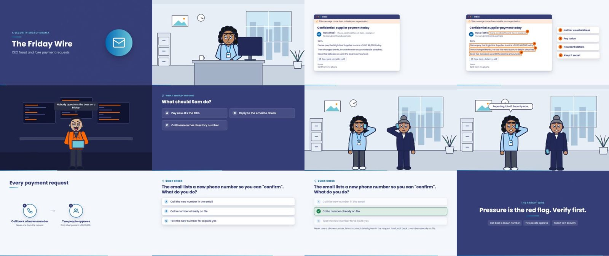
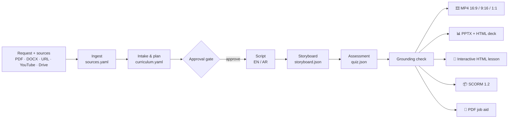
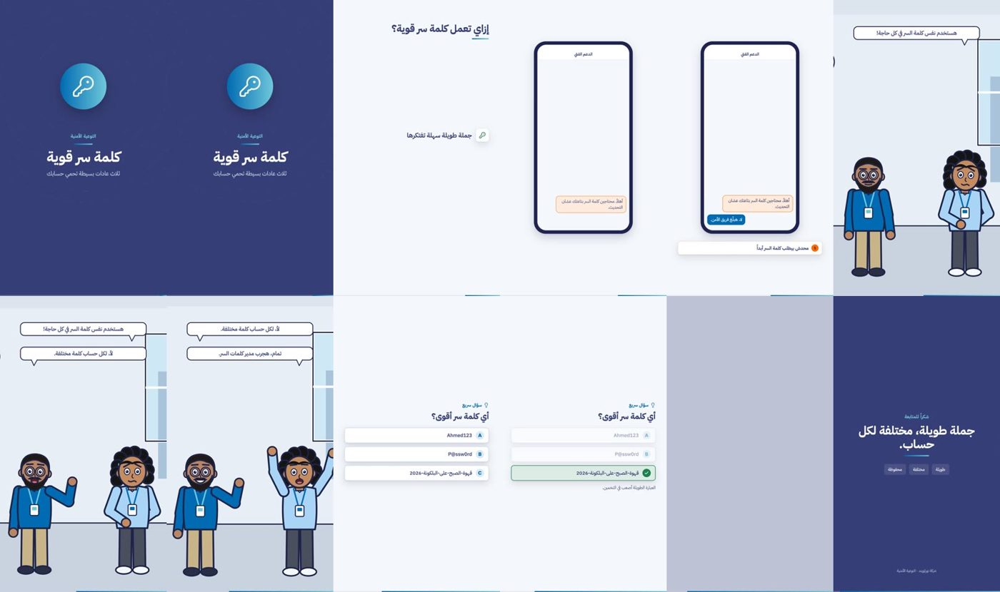
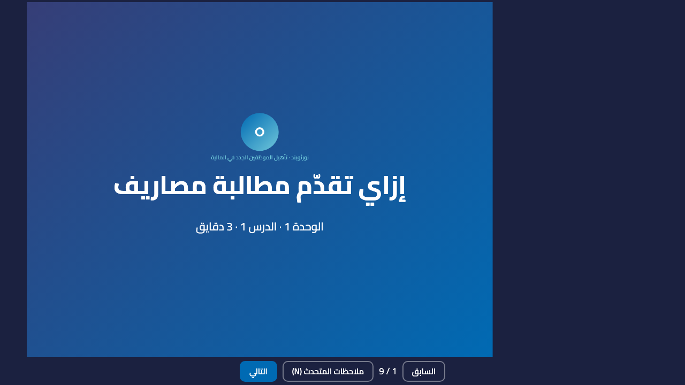

<div align="center">

# 🎬 Training Content Studio

**Turn any subject + your documents into finished, grounded training.**
Video · narrated decks · interactive HTML lessons · SCORM 1.2 · PDF job aids, in **English and Arabic (Egyptian / MSA, RTL)**.

`22 skills` · `10 formats` · `32 scene templates` · `6 outputs` · `/tcs-autopilot` · works in Claude Code, ChatGPT and Gemini

</div>



---

## Contents
[What it does](#what-it-does) · [60-second quickstart](#60-second-quickstart) · [How-to recipes](#how-to-recipes) ·
[Gallery](#gallery) · [Formats](#formats) · [Skills](#the-skill-set) · [Autopilot flags](#autopilot-reference) ·
[Install](#install) · [Quality & testing](#quality--testing) · [Troubleshooting](#troubleshooting) · [Layout](#layout)

## What it does

You describe what people need to learn. The studio acts as a senior instructional designer and a subject-matter
expert. It asks only what's missing, shows you a plan, and after you approve it produces the whole course:



**Built-in guarantees**

| | |
|---|---|
| ✅ **Grounded** | Every claim cites a `source_id` or is labelled `general_knowledge`, and `tcs-grounding-check` verifies it. |
| 🔤 **No AI text in images** | All on-screen text, captions, diagrams and UI mock-ups come from templates. Image generators never draw text. |
| 🛑 **You approve first** | The orchestrator always shows the skeleton and the lesson-1 storyboard before generating. Autopilot only pauses if you ask. |
| 🌍 **Arabic is first-class** | RTL layouts, Arabic fonts, Egyptian or MSA narration, cultural adaptation, subtitles. |
| 🧩 **Any subject** | Add sources or a domain pack (`domains/`); the core skills never change. |
| 🪶 **Token-lean** | SKILL.md files stay under 300 lines; references load on demand; large sources are chunked and summarized. |

## 60-second quickstart

```bash
git clone https://github.com/TamerElsherif/tamer-skills
cd tamer-skills/training-content-studio
uv venv -p 3.12 .venv && uv pip install -p .venv/bin/python -r tools/requirements.txt
bash kit/setup.sh                      # video kit (Node 18+, ffmpeg); skip if you only need decks/SCORM
export OPENAI_API_KEY=...              # narration + transcription; PEXELS_API_KEY optional for stock b-roll
claude --plugin-dir .                  # load the plugin in Claude Code
```
Then just ask:
```
make a short course to teach my team Excel pivot tables
```
Or skip every question:
```
/tcs-autopilot "Teach new hires how to submit expenses in NetSuite" --sources ./sop/expenses.pdf
```

## How-to recipes

### 1. Build a course with you in the loop (orchestrator)
```
/tcs-orchestrator "Onboarding course on our refund policy for customer-service agents" (attach refund-policy.pdf)
```
1. It asks only the missing questions, in one round, each with a recommended default ("go with defaults" works).
2. It shows **modules → lessons → objectives → format → duration**, plus a storyboard for lesson 1.
3. You reply `approve` (or edit), and it produces scripts, storyboards, quizzes and the grounding report, then renders.

### 2. Fully automatic course (autopilot)
```
/tcs-autopilot "Explain our new data retention policy to managers" --sources ./policies/ --review skeleton
```
It decides audience, objectives, length, formats, language and outputs, logs each decision with a confidence score in
`decisions.md`, pauses after the plan (because of `--review skeleton`), then QA-fixes, renders and writes `REPORT.md`.
Resume with `--resume <run-id>`.

### 3. Arabic microlearning from an SOP folder
```
/tcs-autopilot "كورس قصير من 3 وحدات للموظفين الجدد عن إجراءات المشتريات" --sources ./sop/ --lang ar --targets video,lesson,scorm,jobaid
```
You get Egyptian Arabic narration (MSA if your wording is formal), RTL layouts, English subtitles, SCORM and a printable job aid.

### 4. A 90-second security micro-drama with a branching choice and a quiz
```
/tcs-orchestrator "90-second micro-drama on CEO-fraud payment requests, with a branching choice and a quick quiz, for all staff"
```
Uses the `security-awareness` domain pack (personas, red-flag mock-ups, ISO 27001 A.6.3 evidence line).
→ See `examples/golden-security-microdrama/`.

### 5. Turn an existing English lesson into Arabic
```
/tcs-localize make an Egyptian Arabic version of lesson M1L1 in runs/<id>
```
It adapts rather than translates, swaps cultural examples, mirrors layouts, picks Arabic voices, runs `rtl_lint`
and builds SRT/VTT subtitles.

### 6. Prioritize a big course catalogue
```
/tcs-curriculum rank this catalogue spreadsheet and pick the top 20 for staff, IT and executives
```
It scores each course on **impact × frequency × gap × urgency × compliance** with tunable weights, dedupes subjects,
applies audience quotas and gives a reason for each tier.

### 7. Only export: SCORM, deck or job aid from an existing storyboard
```bash
.venv/bin/python skills/tcs-render-lesson/scripts/html_lesson.py runs/<id> --lesson M1L1
.venv/bin/python skills/tcs-render-lesson/scripts/scorm.py --run runs/<id>
.venv/bin/python skills/tcs-render-lesson/scripts/deck.py runs/<id> --lesson M1L1
.venv/bin/python skills/tcs-render-lesson/scripts/jobaid.py runs/<id> --lesson M1L2
```

### 8. Render video (standalone or through OpenMontage)
```bash
.venv/bin/python skills/tcs-render-remotion/scripts/render_lesson.py runs/<id> --target video            # 16:9
.venv/bin/python skills/tcs-render-remotion/scripts/render_lesson.py runs/<id> --target video-vertical   # 9:16
OPENMONTAGE_ROOT=~/OpenMontage .venv/bin/python skills/tcs-render-remotion/scripts/render_lesson.py runs/<id> --target video --engine openmontage
```
Missing keys or assets never stop the run: placeholders are used and listed in `missing_assets.json` / `REPORT.md`.

### 9. Use it from ChatGPT or Gemini
Open `portable/README.md`: paste `portable/SYSTEM_PROMPT.md` into a custom GPT or Gem and attach `portable/attachments/`.
It plans and writes the same `storyboard.json` / `quiz.json`, then hands you the render commands.

## Gallery

| Narrated deck (from an SOP) | Arabic 9:16 (Egyptian, RTL) |
|---|---|
|  |  |

| One-page PDF job aid | Arabic HTML deck |
|---|---|
|  |  |

**Template gallery**: some of the 32 scene templates (definition, icon grid, steps, timeline, comparison, table,
stat, email, browser and MFA mock-ups, code, decision, outro…):


## Formats

| Format | Best for | Skill |
|---|---|---|
| Explainer (+ B-roll, motion graphics) | concepts, "what & why" | `tcs-format-explainer` |
| Whiteboard / doodle | processes, simple ideas, friendly tone | `tcs-format-doodle` |
| 2D cartoon micro-drama | behaviour, judgement, compliance stories | `tcs-format-cartoon` |
| Comic / webtoon | quick stories, mobile reading | `tcs-format-comic` |
| Narrated deck | executives, policies, briefings | `tcs-format-narrated-deck` |
| Expanding mind map | abstract structures, overviews | `tcs-format-mindmap` |
| Branching scenario | decisions with consequences | `tcs-format-branching` |
| Screencast + simulation | software procedures, guided practice | `tcs-format-screencast-sim` |
| Job aid / cheat sheet | on-the-job reference (pairs with any format) | `tcs-format-job-aid` |
| Episodic series + nudges | multi-week adoption, points, streaks, flashcards | `tcs-format-series` |

Blends are composed automatically (max 2 formats per lesson, 3 per course), e.g. *cartoon + branching + quiz* or *explainer + job aid*.

## The skill set

| Stage | Skill | What it does |
|---|---|---|
| Entry | `tcs-orchestrator` | Intake (one round, with defaults) → approval gate → routes everything |
| Entry | `tcs-autopilot` | `/tcs-autopilot`: no questions, resumable, writes `decisions.md` + `REPORT.md` |
| Plan | `tcs-source-ingest` | Files, folders, URLs, YouTube/Vimeo, Drive/OneDrive (rclone) → `sources.yaml` |
| Plan | `tcs-curriculum` | Bloom objectives, modules, durations, catalogue prioritization → `curriculum.yaml` |
| Write | `tcs-scriptwriter` | Format-aware narration in EN and AR, `^` visual cues, source-tagged claims |
| Write | `tcs-storyboard` | Script → `storyboard.json` (32 templates) + approval-gate preview |
| Write | `tcs-assessment` | Knowledge checks, scenarios, pre-tests, flashcards → `quiz.json` (+ GIFT/CSV) |
| Check | `tcs-grounding-check` | Verifies claims; flags unsupported, conflicting, outdated |
| Adapt | `tcs-localize` | AR↔EN adaptation, RTL, glossary, voices, subtitles |
| Render | `tcs-render-remotion` | Standalone MP4 renderer (default) |
| Render | `tcs-render-openmontage` | MP4 through your OpenMontage install (shows on the Backlot board) |
| Render | `tcs-render-lesson` | HTML lesson, PPTX/HTML deck, SCORM 1.2, PDF job aid |
| Format | `tcs-format-*` (10) | Playbook, beats, templates and examples per format |

Every skill reads and writes only these contracts (`schemas/`): `sources.yaml` · `curriculum.yaml` ·
`<L>.storyboard.json` · `<L>.quiz.json` · `grounding_report.json` · `decisions.json` · `state.json`.

## Autopilot reference

```
/tcs-autopilot "<request>" [--sources <paths|urls|folder>] [--lang ar|en|both]
               [--targets video,deck,lesson,scorm,jobaid] [--aspect 16:9|9:16|1:1]
               [--review none|skeleton|final] [--budget <tokens|$>] [--domain <pack>] [--resume <run-id>]
```

| Signal | Default decision |
|---|---|
| "new hires", "my team", "engineers", jargon | beginner, beginner-intermediate or intermediate |
| *know / do / decide* verbs | Bloom remember-understand / apply / analyze-evaluate |
| procedure or software | screencast-sim + job aid |
| behaviour, judgement or compliance | cartoon micro-drama + branching + quiz |
| managers or executives | narrated deck (+ job aid) |
| Arabic request or MENA context | Arabic primary (Egyptian) + English subtitles, 10% slower narration |
| ≥ 2 lessons | adds SCORM; video formats add a 9:16 cut |
| high-stakes topic with no sources | plans only and asks for sources |

Tune everything in `skills/tcs-autopilot/decision-rules.yaml`. Explicit flags or wording always override.

## Install

```bash
# whole plugin (recommended)
git clone https://github.com/TamerElsherif/tamer-skills && claude --plugin-dir tamer-skills/training-content-studio
# a single skill (its scripts still need the plugin root for schemas/, kit/, assets/)
npx skills add TamerElsherif/tamer-skills --skill tcs-orchestrator --agent claude-code
```

| Need | For |
|---|---|
| Python 3.12 + `tools/requirements.txt` | every script |
| Node 18+, ffmpeg, `bash kit/setup.sh` | video renders |
| Google Chrome | PDF job aids, screenshots |
| `OPENAI_API_KEY` | narration (gpt-4o-mini-tts) + transcription (whisper-1) |
| `PEXELS_API_KEY` (optional) | stock b-roll |
| `OPENMONTAGE_ROOT` (optional) | render through OpenMontage |
| `yt-dlp` (installed via requirements) | YouTube/Vimeo ingest |

Keys can also come from a file named in `TCS_ENV_FILE`; they are never written to disk.

## Quality & testing

`QUALITY.md` is the release checklist (grounding, objective coverage, accessibility, Arabic rendering, no text in
generated images, licences, duration).

```bash
.venv/bin/python tools/validate.py                               # schemas, contracts, SKILL.md limits, 24 routing cases
.venv/bin/python tools/qa.py runs/<id>                           # per-lesson gate → qa/<L>.qa.json
.venv/bin/python skills/tcs-autopilot/scripts/test_decisions.py  # 9 golden autopilot decisions
bash skills/tcs-render-lesson/tests/run_all.sh                    # HTML / deck / SCORM / job-aid regression
```

| Example | What it shows |
|---|---|
| `examples/golden-security-microdrama/` | Intake → approved plan → cartoon + branching storyboard → quiz → grounding (21/24 sourced, 3 general knowledge) → 87 s MP4 + HTML + SCORM |
| `examples/golden-sop-deck-jobaid/` | SOP PDF → narrated deck in EN + Egyptian Arabic (152 s MP4, PPTX, HTML) + one-page job aid + 2-lesson SCORM |
| `examples/autopilot-runs/g1–g3` | The three golden autopilot decisions |

## Troubleshooting

| Symptom | Fix |
|---|---|
| Video has no voice | `OPENAI_API_KEY` is missing; check `work/missing_assets.json` |
| Silent background | no music bed shipped; add files to `assets/music/` or set `TCS_MUSIC_DIR` |
| `RENDER_PENDING.md` instead of an MP4 | Node, ffmpeg or OpenMontage not found; the file lists the exact command to run |
| QA fails on grounding | read `<L>.grounding_report.md`: re-cite, soften, or label as general knowledge |
| Arabic looks left-to-right | `language` must be `ar-EG` or `ar-MSA` with `direction: rtl`; run `skills/tcs-localize/scripts/rtl_lint.py` |
| SCORM not tracking | run `scorm_check.py`; test once in your LMS sandbox |

## Layout

```
.claude-plugin/plugin.json   plugin manifest
skills/       22 skills (SKILL.md + references/ templates/ scripts/ tests/)
schemas/      JSON Schemas for every contract + enums.json
kit/          Remotion template kit shared by both video renderers (32 templates, 10 personas, RTL)
assets/       MANIFEST.md, themes, layouts, captions, voices, personas, placeholders
domains/      _template/ and security-awareness/ (glossary, personas, scenarios, weights, compliance)
examples/     golden examples + autopilot golden runs
portable/     system prompt + attachments for a ChatGPT GPT / Gemini Gem
tools/        validate.py · qa.py · trigger_cases.yaml · gen_skill_readmes.py
docs/         images, build brief, developer notes
```

## Licensing notes

The plugin calls OpenMontage (AGPLv3) only as an external tool; none of its source is included. Remotion needs a
company licence for organisations with more than 3 employees. Fonts are OFL. Stock b-roll comes from Pexels, with the
licence recorded per clip.

## Changelog
- 2026-11-18: README rewritten with how-to recipes, gallery and reference tables.
- 2026-11-17: 1.0.0. 22 skills, 7 schemas, render kit, 2 golden examples, 3 golden autopilot runs.
